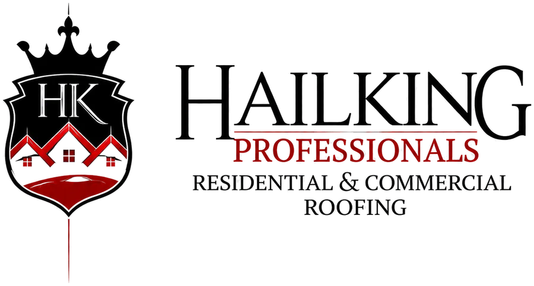
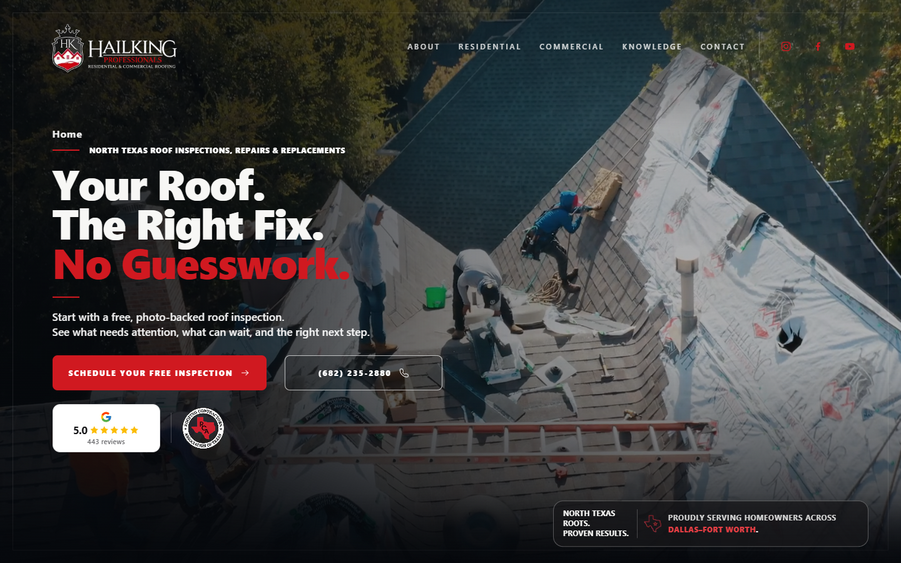
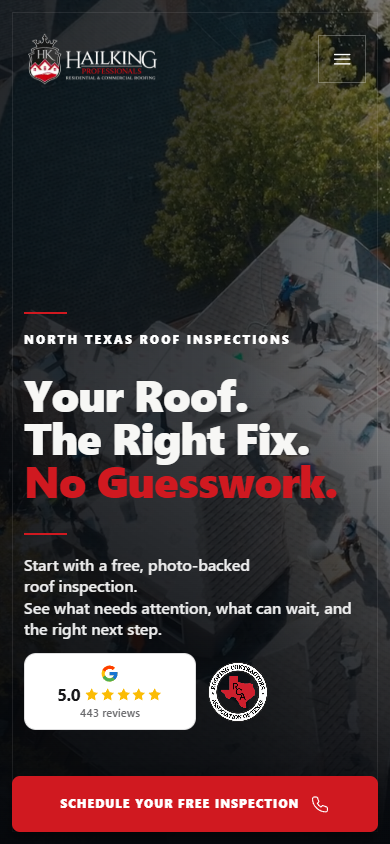

<p align="center">
  <a href="https://hailkingpros.com/">
    
  </a>
</p>

<h1 align="center">Your roof. The right fix. No guesswork.</h1>

<p align="center">
  HailKing Professionals helps North Texas homeowners, property managers, and businesses understand what their roof needs—and what it does not.
</p>

<p align="center">
  <strong><a href="https://hailkingpros.com/">Explore the new HailKing Professionals website →</a></strong>
</p>

---

## Roofing decisions start with clear evidence

HailKing Professionals is a North Texas residential and commercial roofing company serving Dallas–Fort Worth. The team starts with a photo-backed inspection, documents the condition of the roof, and explains the practical next step before work is approved.

That may mean addressing a contained repair, restoring a viable commercial roof, or planning a complete replacement. The recommendation is built around the property, the roof system, and the people who depend on it.

## Residential and commercial roofing services

| Residential roofing | Commercial roofing | Storm and roof evaluation |
| --- | --- | --- |
| Roof inspections | Commercial roof inspections | Hail and wind damage inspections |
| Roof repairs | Leak, seam, flashing, and membrane repairs | Photo-backed damage documentation |
| Roof replacements | Roof restoration and coatings | Repair-scope development |
| Material and system guidance | Full roof replacement | Insurance-review support |
| Clean, coordinated installation | TPO, PVC, EPDM, modified bitumen, built-up, liquid-applied, coating, and metal systems | Forensic and diagnostic roof evaluation |

Commercial work can be planned around occupants, tenant communication, deliveries, access, equipment, and daily operations. Residential recommendations balance weather protection, appearance, long-term value, and a clean jobsite.

## See the new website

[](https://hailkingpros.com/)

<p align="center">
  <a href="https://hailkingpros.com/">
    
  </a>
</p>

The new site gives homeowners and commercial property teams a clearer path through inspections, roof-system options, storm-damage questions, repair-versus-replacement decisions, and the next step for scheduling an inspection.

**[Visit hailkingpros.com](https://hailkingpros.com/)**

## About this public repository

This is a deliberately sanitized, static showcase for selected parts of the HailKing web experience. It demonstrates presentation components, responsive layouts, synthetic page examples, the public design system, and a tightly approved collection of brand assets.

It is not the production source repository, does not serve production traffic, and cannot access HailKing production systems.

### Public showcase

- Static Next.js App Router implementation
- Responsive presentation components and page compositions
- HailKing design foundations and approved marks
- Synthetic residential and commercial examples
- Desktop and mobile captures of the public homepage
- Architecture, accessibility, threat-model, and publication-boundary documentation

All committed media is recorded and integrity-locked in [`public/asset-manifest.json`](public/asset-manifest.json). See [TRADEMARKS.md](TRADEMARKS.md) for ownership notices and [PUBLIC-SCOPE.md](PUBLIC-SCOPE.md) for the publication boundary.

## Local development

Requirements: Node.js 20.9 or newer.

```bash
npm ci
npm run dev
```

Verify the static project with:

```bash
npm run safety
npm run lint
npm run build
npm audit --audit-level=high
```

Build output is written to `out/`. This repository is not configured for deployment.

## Security and rights

Report suspected exposure privately according to [SECURITY.md](SECURITY.md). Do not open a public issue containing sensitive information.

The source is publicly viewable but is not offered under an open-source license. See [LICENSE.md](LICENSE.md).
